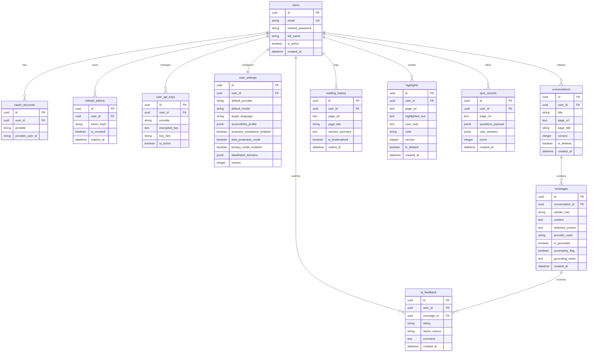

# Database Relationships & Entity-Relationship Diagram (ERD)

## 1. Entity-Relationship Diagram

## 2. Foreign Key & Cascade Policies
- **User Cascade**: When a `user` is deleted, all dependent records (`oauth_accounts`, `refresh_tokens`, `user_api_keys`, `user_settings`, `conversations`, `reading_history`, `highlights`, `quiz_records`, `ai_feedback`) are **CASCADED** (`ON DELETE CASCADE`).
- **Conversation Cascade**: When a `conversation` is deleted, child `messages` are **CASCADED** (`ON DELETE CASCADE`).
- **Message Cascade**: When a `message` is deleted, its `ai_feedback` is **CASCADED**.
- **Index Recommendations**:
  - `users(email)`: Unique index.
  - `user_api_keys(user_id, provider)`: Unique index.
  - `reading_history(user_id, visited_at DESC)`: B-tree index for efficient pagination.
  - `highlights(user_id, page_url)`: B-tree index for page-level highlight retrieval.
  - `conversations(user_id, updated_at DESC)`: Index for recent conversation lookups.
  - `messages(conversation_id, created_at ASC)`: Chronological retrieval.
  - `quiz_records(user_id, created_at DESC)`: Historical quiz reviews.
